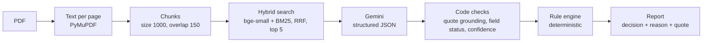

# ContractGuard

ContractGuard checks a vendor contract (PDF) against a company's rules and returns
**PASS / FAIL / NEEDS_REVIEW / NOT_APPLICABLE** for each rule, with a quote from the
contract as evidence.

> **Demo only. Do not upload real or confidential contracts.**
> The app runs on your machine, but parts of the contract text are sent to Google
> Gemini for extraction. On the free tier, Google may use that data.

This is a working prototype built to learn and show how to make an LLM system that is
**measured, safe and auditable**. It is not a production system.

---

## What it does

- Reads a contract PDF and finds two clause types: **Renewal Term** and **Cap On Liability**.
- Extracts values from those clauses with an LLM (Gemini), as structured JSON.
- Checks the LLM's evidence with code: the quote must really exist in the contract.
- Decides each rule with a fixed rule engine (code, not the LLM).
- When the proof is weak, it does not guess. It says **NEEDS_REVIEW** and a person checks.

The 5 rules (in `policies/eval_policy.json`):

| Rule | Clause | Question |
|---|---|---|
| `cap_required` | Cap On Liability | Is there a liability cap? |
| `cap_min_2m` | Cap On Liability | Is the cap at least USD 2,000,000? |
| `excludes_consequential` | Cap On Liability | Are consequential damages excluded? |
| `renewal_notice_min_30` | Renewal Term | If it renews automatically, is the notice at least 30 days? |
| `initial_term_max_60` | Renewal Term | Is the first term 60 months or less? |

## How it works



- **The LLM only reads.** It extracts values and a quote. It never decides PASS or FAIL.
- **Code checks the evidence.** Each value gets a status (for example `supported`,
  `keyword_signal`, `explicit_negative`, `absence_claim`, `unsupported`). Confidence is
  computed by code only, never taken from the LLM.
- **Code decides.** The rule engine trusts only well-supported values (trust policy
  `KEYWORD`). Everything else becomes NEEDS_REVIEW.
- **Only the relevant chunks go to Gemini** (top 5 per clause type), not the whole contract.

## Results (measured)

Data: contracts from CUAD. 30 contracts were used to design the system. 12 other
contracts were kept as a **held-out test**: the success rules were written down before
the run (`docs/heldout_preregistration.md`), and the test was run once (git tag `heldout-v1`).

| Metric | 30 design contracts | 12 held-out contracts (the honest test) |
|---|---|---|
| Unsafe decisions (wrong automatic PASS/FAIL) | 0 of 101 scored rule checks | 0 of 45 scored rule checks |
| Decided automatically | 42 of 101 | 16 of 45 (36%) |
| FAILs caught automatically | 2 of 18 | 1 of 9 |
| Extraction fully correct (per clause) | 47–50 of 60 | 16 of 24 (67%) |

What these numbers mean, honestly:

- **Safe:** 0 unsafe decisions in 146 scored rule checks. With this sample size the true
  unsafe rate is probably under about 2% (rule of three), not proven to be zero.
- **Careful, not very automatic:** about one third of the rule checks are decided without a
  human. The rest go to review.
- **Weak at catching FAILs:** most real FAILs end up as NEEDS_REVIEW, not as an automatic FAIL.
- On the held-out set, 24 reviews were unnecessary: the value was correct but not proven (12),
  retrieval missed the clause (7), confidence was low (4), extraction was wrong (1).

An optional **evidence follow-up loop** tries to find more proof for unproven values. It was
tested against a bar set in advance and missed it twice (9 fewer reviews, needed 10; then
2 fewer, needed 5). So it stays **opt-in**, off by default.

### After the held-out test (post-hoc)

The numbers above are the frozen, pre-registered result. Later changes were measured again,
each against a bar written before its run. Because these sets had already been seen, the
numbers below are **post-hoc**: they show a change works, not that it generalises.

**Stress test.** 4 synthetic contracts with fictional parties and deliberately hard wording
(for example a USD 1,500,000 liability cap next to USD 5,000,000 of insurance), with the true
answer for all 20 rule checks written before the run.

| | Unsafe | Decidable rows decided correctly | FAILs caught |
|---|---|---|---|
| First run | 0 of 20 | 6 of 16 | 0 of 6 |
| After fix A | 0 of 20 | 9 of 16 | 2 of 6 |

**Fix A (kept).** The evidence check for the cap amount did not recognise `USD 5,000,000`,
`five million United States dollars`, or a number at the end of a sentence (`$1,000,000.`).
It now does, for the cap amount only. Result: design set unchanged (0 unsafe, 42 of 101);
held-out set 0 unsafe, 17 of 45 automatic, FAILs caught 2 of 9 (was 1 of 9).

**Search near the quote (not kept).** Letting the code prove the initial term from the text
around the quote worked on the synthetic contracts but changed no row on the real ones (real
contracts say, for example, "until the end of the fifteenth (15th) Contract Year"). By its
pre-registered bar it was removed. The code is kept in `experiments/option1_context_window.patch`.

## Why not just ask a chatbot?

For one contract and one question, a chatbot is fine and more flexible. ContractGuard is for
the case where the **same rules** must be checked the **same way** on many contracts, with proof.

| | Chatbot | ContractGuard |
|---|---|---|
| Who decides PASS or FAIL | The model, in free text | A fixed rule engine (code) |
| Is the quote real? | May misquote | Code checks the quote exists in the contract |
| When unsure | Often still answers | NEEDS_REVIEW, sent to a person |
| Known error rate | No | Yes, measured on labelled contracts |
| Audit trail | Chat log | History row: file hash, policy hash, prompt version |
| Cost control | None | Daily cap |

It is not smarter than a chatbot. It is more controlled.

## Quick start

You need a Gemini API key (Google AI Studio). Put it in a file named `.env` in the repo root
(the file is git-ignored). Do not put quotes around the value:

```
GEMINI_API_KEY=your-key-here
```

### Option A: Docker

```bash
docker build -t contractguard .
docker run -d --name contractguard -p 127.0.0.1:8000:8000 --env-file .env \
  -v contractguard-cache:/app/.cache contractguard
```

Open <http://127.0.0.1:8000/>. Useful commands:

```bash
docker ps                      # is it running?
docker logs --tail 20 contractguard     # requests and status codes
docker stop contractguard               # stop
docker start contractguard              # start again (history is kept in the volume)
```

The image is about 2.4 GB (CPU-only PyTorch and the embedding model are inside it). It runs as a
non-root user with one worker, and is published on `127.0.0.1` only.

### Option B: Local (Python 3.12 + uv)

```bash
uv sync
uv run --env-file .env uvicorn --factory contractguard.api.app:create_app \
  --host 127.0.0.1 --port 8000
```

Open <http://127.0.0.1:8000/>. The first start downloads the embedding model
(`BAAI/bge-small-en-v1.5`). After that you can add `HF_HUB_OFFLINE=1` in front of the command.

Only one server can use port 8000: stop the Docker container before starting the local server.

### The demo page

- **Check tab:** upload a PDF, get the overall status, the 5 rule decisions with reason and
  quote, and the cost (LLM calls, cache hits, tokens, time).
- **Model found:** for each rule the page shows the value the model read (for example
  "36 months") and, for rows in review, why it is not trusted ("not proven by the quote").
  In review rows the quote is often a different sentence, so this tells the reviewer what to
  look for. The page never suggests PASS or FAIL for a row in review, to avoid biasing the reviewer.
- **History tab:** the newest 50 checks; click **Details** to see the rule decisions of one check.

The page has no API key box. It works when API-key authentication is off (the default when
`CONTRACTGUARD_API_KEY` is not set). This is for a localhost demo only.

### Command line

```bash
uv run --env-file .env python -m contractguard.check path/to/contract.pdf \
  --policy policies/eval_policy.json --json-out report.json
```

Add `--followup --followup-version v2` to turn on the evidence follow-up loop.

## API

| Endpoint | Key needed* | What it does |
|---|---|---|
| `GET /` | No | The demo page |
| `GET /health` | No | Status, limits, whether auth and history are on |
| `GET /policy` | Yes | The rules in use |
| `POST /check` | Yes | Check one PDF (multipart `file`, form field `followup`) |
| `GET /checks` | Yes | History list; filters: `name`, `sha256`, `status`, `date_from`, `date_to`, `limit`, `offset` |
| `GET /checks/{id}` | Yes | One check with its rule decisions |

\* Only when `CONTRACTGUARD_API_KEY` is set. Then send it in the `X-API-Key` header.

Errors always look like `{"detail": {"code": "...", "message": "..."}}`:

| Status | Code | Meaning |
|---|---|---|
| 401 | `unauthorized` | Missing or wrong API key |
| 404 | `not_found` | No check with this id |
| 413 | `file_too_large` | File over the size limit |
| 415 | `not_a_pdf` | The file is not a PDF |
| 422 | `unreadable_pdf`, `empty_pdf`, `too_many_pages`, `scanned_pdf` | The PDF cannot be used |
| 429 | `busy` | Another contract is being checked (one at a time) |
| 429 | `daily_limit_reached` | Daily cap reached; see the `Retry-After` header |
| 503 | `llm_quota_exhausted` | Gemini limit reached |
| 503 | `history_unavailable` | History database cannot be used, so checks are stopped |
| 500 | `internal_error` | Unexpected error (details only in the server log) |

## Settings (environment variables)

| Variable | Default | Meaning |
|---|---|---|
| `GEMINI_API_KEY` | (required) | Key for Gemini |
| `CONTRACTGUARD_API_KEY` | not set | If set, the API needs this key. Not set = auth off |
| `CONTRACTGUARD_POLICY` | `policies/eval_policy.json` | Rules file. A bad file stops the server at startup |
| `CONTRACTGUARD_MAX_UPLOAD_MB` | `10` | Largest upload |
| `CONTRACTGUARD_MAX_PAGES` | `200` | Most pages |
| `CONTRACTGUARD_CACHE_DIR` | `.cache/api_llm_cache` | Cache of LLM answers for the API |
| `CONTRACTGUARD_DB_PATH` | `.cache/history.db` | SQLite history file |
| `CONTRACTGUARD_DAILY_CAP` | `30` | Checks allowed in any 24 hours |
| `CONTRACTGUARD_HISTORY_MODE` | `metadata` | `metadata` = store decisions only, no quotes; `full` = store the whole report |

## History and daily cap

Every `/check` request is saved in SQLite (built-in `sqlite3`, no extra dependency):

- `checks`: one row per request: time, file name, file hash, policy hash, prompt version,
  status or error code, LLM calls, tokens, time taken.
- `check_rules`: one row per rule result: rule id, decision, reason code.

The daily cap counts the checks of the last 24 hours that reached the pipeline. When the cap is
reached the API answers 429 and makes no LLM call. If the history database cannot be read, the
API answers 503 and makes no LLM call (fail closed): a cap that cannot count is not a cap.

One check without follow-up makes 2 LLM calls (one per clause type).

## Tests and evaluation

```bash
.venv/bin/python -m pytest -q        # 713 tests, all offline
.venv/bin/ruff check src tests evals
```

The evaluation scripts are in `evals/`:

| Script | What it does |
|---|---|
| `eval_extraction.py` | Scores extracted values against hand labels |
| `run_checker_batch.py` | Runs the full checker on the labelled contracts (cache-only by default) |
| `eval_rules.py` | Scores rule decisions against hand labels, per trust policy |
| `eval_verdicts.py` | Explains each saved decision against the labels |
| `eval_followup.py` | Compares saved reports before and after the follow-up loop |

The LLM answers used for the results are committed in `evals/llm_cache`, so the results can be
re-computed offline with 0 API calls. Each script has `--help`. The held-out protocol, the
success rules and the amendments are in `docs/heldout_preregistration.md`; the saved result
files are in `evals/` (for example `checker_batch_summary_heldout.txt`).

## Key design decisions

Each one has a written reason and, where possible, a measurement in `docs/decisions.md`.

- **The LLM extracts, code decides.** Decisions come from a deterministic rule engine.
- **Confidence comes from code only**, never from the LLM's own opinion.
- **A "no" from the LLM is not trusted** (`explicit_negative`): it goes to review.
- **Trust policy `KEYWORD`**, picked on the design set and picked again on the held-out set.
- **Follow-up loop is opt-in:** it missed its pre-registered bar twice.
- **Plain Python, not LangGraph:** both gave identical results, so the simpler one stayed.
- **CPU-only PyTorch:** 0 decision differences on 150 rule checks; smaller image.
- **No reranker; hybrid search (dense + BM25) with top 5.**
- **One check at a time, one worker:** simple and predictable on a small machine.
- **Rules are fixed on the server.** Users cannot upload their own rules.
- **No cloud deploy:** Docker locally, for privacy.
- **Success rules are written before each experiment** and never moved after the results.
- **A change is kept only if it helps on real contracts.** Gains on synthetic contracts alone
  are not enough (the "search near the quote" change was removed for this reason).
- **No suggested verdicts for rows in review.** The page shows what the model read, not what
  the reviewer should decide.

## Known limits and next steps

- One quote per clause, not per value. A correct value whose sentence is not the quoted one
  goes to review (the most common cause of unnecessary reviews). Per-field evidence quotes are
  the top accuracy step.
- Yes/no values (for example "damages are excluded") cannot be proven by keywords alone:
  wording such as "excluded only to the extent set out in Schedule 4" needs a person.
- Proving that something is absent ("there is no cap") is not solved; these go to review.
- Retrieval sometimes misses the clause.
- Formula caps ("the lesser of ...") and "Contract Year" durations are not handled well.
- Only 2 clause types and 5 rules.
- No login. With auth off, the guards are: bound to localhost, and the daily cap.
- Scanned PDFs are not supported (no OCR).
- No deletion of old history rows.

## Project layout

```
src/contractguard/
  ingestion/   PDF to text
  chunking/    text to chunks
  retrieval/   hybrid search (dense + BM25)
  extraction/  prompts, schemas, LLM extraction
  llm/         Gemini client, cache, errors
  rules/       rule definitions and rule engine
  followup/    optional evidence follow-up loop
  api/         FastAPI app, SQLite history, demo page (static/index.html)
  checker.py   the full pipeline for one contract
  check.py     command line
  report.py    the report model
evals/         evaluation scripts, labels, saved results, LLM cache
policies/      the rules file
docs/          decisions.md, heldout_preregistration.md, labeling_guide.md
tests/         offline tests
dockerfile     container image
```

## Data and credits

Contracts and clause labels come from **CUAD** (Contract Understanding Atticus Dataset) by
The Atticus Project, licensed under CC BY 4.0.

Hendrycks, D., Burns, C., Chen, A., Ball, S. (2021). *CUAD: An Expert-Annotated NLP Dataset
for Legal Contract Review.* <https://www.atticusprojectai.org/cuad>
